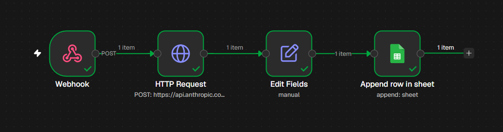

# Centralizador de leads con IA (n8n + API de Claude)

Flujo de automatización hecho con **n8n** que recibe los mensajes de los clientes de un bar, los **clasifica con la API de Claude** en *reserva*, *pregunta* o *queja* y los **guarda en Google Sheets**, sin que nadie tenga que leerlos uno a uno.



## Qué hace
Entra un mensaje:
```json
{ "nombre": "Marta", "mensaje": "Querría reservar mesa para 2 el sábado" }
```
Y se añade una fila en la hoja:

| Fecha | Nombre | Mensaje | Categoria |
|---|---|---|---|
| 2026-11-17T12:30 | Marta | Querría reservar mesa para 2 el sábado | reserva |

## Cómo funciona
1. **Webhook**: recibe el mensaje del cliente (`nombre` y `mensaje`) por POST.
2. **HTTP Request**: llama a la API de Claude (modelo `claude-haiku-5-5`, rápido y barato) con un prompt de sistema que le obliga a contestar **solo con una palabra**: `reserva`, `pregunta` o `queja`.
3. **Edit Fields**: se queda con los datos limpios (nombre, mensaje y categoría).
4. **Google Sheets**: añade una fila con la fecha, el nombre, el mensaje y la categoría.

## Probarlo
1. Importa [`centralizador-leads.json`](centralizador-leads.json) en n8n (**Workflows → Import from file**).
2. En el nodo **HTTP Request**, cambia `PON_AQUI_TU_CLAVE_DE_ANTHROPIC` por tu clave de API de Anthropic.
3. En el nodo **Google Sheets**, conecta tu cuenta de servicio de Google y elige una hoja con las columnas `Fecha`, `Nombre`, `Mensaje` y `Categoria`.
4. Pulsa **Execute workflow** y envía un mensaje de prueba:

```bash
curl -X POST http://localhost:5678/webhook-test/lead-bar \
  -H "Content-Type: application/json" \
  -d '{"nombre": "Marta", "mensaje": "Querría reservar mesa para 2 el sábado"}'
```

En Windows (PowerShell):
```powershell
Invoke-RestMethod -Method Post -Uri http://localhost:5678/webhook-test/lead-bar -ContentType "application/json" -Body '{"nombre": "Marta", "mensaje": "Querría reservar mesa para 2 el sábado"}'
```

## Por qué
Es una recreación, con un bar y clientes **inventados**, de un sistema real de centralización de leads que desarrollé en mis prácticas (con la API de Claude y MCP). Aquí lo monto con una herramienta no-code para enseñar el mismo concepto de forma sencilla.

## Problemas que encontré y cómo los resolví
- **Mensajes con comillas.** Si un cliente escribía `¿Tenéis la "tortilla de la abuela"?`, el nodo de Claude fallaba con *"The value in the JSON Body field is not valid JSON"*: el texto se metía tal cual dentro de unas comillas, y las comillas del cliente cerraban el texto antes de tiempo. Es el mismo problema de fondo que una inyección SQL: meter texto del usuario dentro de código sin escaparlo.
  - Antes: `"content": "{{ $json.body.mensaje }}"`
  - Ahora: `"content": {{ JSON.stringify($json.body.mensaje) }}` → `JSON.stringify` pone las comillas y escapa las de dentro.
- **Mapeo de columnas perdido.** Al mover el flujo a otro equipo y volver a elegir la hoja, n8n borró qué dato va en cada columna y el último nodo fallaba (*"At least one value has to be added under 'Values to Send'"*). Lo detecté en el registro de la ejecución y lo resolví con **Map Each Column Manually**.

## Siguientes mejoras
- Guardar la clave de Anthropic como **credencial de n8n** en vez de escribirla en el nodo.
- **Validar la respuesta** de la IA: si no es una de las tres categorías, marcarla como `revisar`.
- Avisar por correo o WhatsApp cuando llegue una **queja**.

---
Hecho por Alejandro Corral · [Más proyectos en GitHub](https://github.com/alejandrocorral509)
